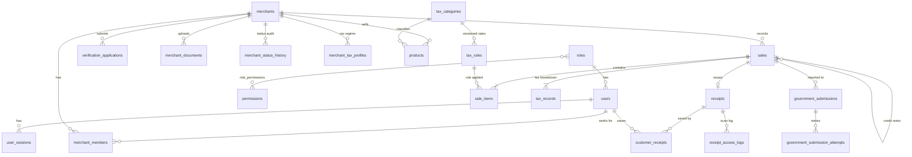

# 03. Physical design (PostgreSQL) and schema overview

## 1. PostgreSQL choices

| Topic | Choice |
|---|---|
| Keys | uuid for business tables; bigint identity for high-volume logs |
| Time | timestamp with time zone, stored in UTC; business dates use Africa/Addis_Ababa |
| Money | exact numeric types |
| Snapshots and API responses | jsonb |
| Statuses | PostgreSQL enum types (23) |
| Indexes | explicit index on every foreign-key column, plus indexes for the main queries |
| Overlapping tax rules | exclusion constraint (needs the `btree_gist` extension) |
| Email | stored in lower case, enforced by a CHECK constraint |
| QR token | must match a fixed format (43 URL-safe characters) |
| Protection | triggers block UPDATE, DELETE and also TRUNCATE on protected tables |

## 2. Entity relationship diagram (main tables)



## 3. Tables (28) by group

| Group | Tables |
|---|---|
| A. Identity and access | roles, permissions, role_permissions, users, user_sessions, password_reset_tokens |
| B. Merchants and verification | merchants, merchant_members, merchant_status_history, document_types, verification_applications, merchant_documents |
| C. Catalog and tax configuration | units_of_measure, tax_categories, tax_rules, merchant_tax_profiles, products |
| D. Sales | sales, sale_items, tax_records, document_sequences |
| E. Receipts and customer access | receipts, customer_receipts, receipt_access_logs |
| F. Tax authority integration | government_submissions, government_submission_attempts |
| G. Platform | audit_logs, notifications |

## 4. Important status values

| Enum | Values |
|---|---|
| merchant_status | PENDING, UNDER_REVIEW, APPROVED, REJECTED, SUSPENDED |
| application_status | PENDING, UNDER_REVIEW, APPROVED, REJECTED |
| sale_type | SALE, CREDIT_NOTE |
| receipt_status | ISSUED, REVOKED |
| legal_status | PLATFORM_RECEIPT, OFFICIAL_ELECTRONIC_INVOICE |
| submission_status | PENDING, SUBMITTED, ACCEPTED, REJECTED, FAILED |
| rule_status | DRAFT, ACTIVE, RETIRED |

## 5. Business rules and how the database enforces them

| Rule | Mechanism |
|---|---|
| Only approved, non-expired merchants can create sales | Trigger on sales |
| Issued records cannot be edited or deleted | Triggers on sales, items, tax records, receipts |
| Corrections use credit notes, capped at the original total | Trigger on sales (locks the original sale) |
| Receipt totals match items and tax records | Trigger on receipts |
| Tax rates are never hard-coded | Versioned rules; a legal reference and approver are required to activate |
| No two active tax rules cover the same dates | Exclusion constraint |
| A line may only use a rule that is active on the sale date, with the same rate | Trigger on sale items |
| A receipt is "official" only after tax-authority acceptance | Trigger on receipts; accepted submissions are final |
| Duplicate requests do not create duplicate sales | Unique idempotency key |
| Receipt numbers have no gaps | Counter function with row locking |
| Audit history cannot be changed | Append-only triggers |
| One merchant cannot link to another merchant's data | Composite foreign keys |

### Ethiopian business dates

Whether a tax rule applies is decided by the sale's date in the Africa/Addis_Ababa time zone, not the UTC date. A sale at 22:00 UTC on 31 December is already 1 January in Ethiopia. Reports group by Ethiopian date too.

## 6. Reporting views

| View | Purpose |
|---|---|
| v_merchant_daily_sales | Net daily sales, minus credit notes |
| v_tax_summary_monthly | Net tax by month, type, category and rate |
| v_sale_official_status | Locally recorded vs. accepted by the tax authority |
| v_submission_backlog | Pending, failed or rejected submissions |
| v_documents_expiring | Merchant documents expiring in 30 days |
| v_integrity_violations | Health check; must always be empty |

## 7. Files in this repository

See [`../postgres/`](../postgres/): `01_schema.sql`, `02_integrity.sql`, `03_seed_reference.sql`, `04_seed_dev.sql`, `05_tests.sh`.

## 8. How to run

Use a **new, empty** database.

```bash
createdb ereceipt
psql -d ereceipt -f database/postgres/01_schema.sql
psql -d ereceipt -f database/postgres/02_integrity.sql
psql -d ereceipt -f database/postgres/03_seed_reference.sql
# optional, development only:
psql -d ereceipt -f database/postgres/04_seed_dev.sql
```

Requirements: PostgreSQL 14 or newer, with the `btree_gist` extension available.

`03_seed_reference.sql` is reference data (roles, permissions, units, document types, tax categories) and contains **no tax rates**. `04_seed_dev.sql` is test data only; its 15% rate is a labelled test fixture, not a legal source.

## 9. Verification

Run the tests on a **throwaway** server, because the script drops and recreates a test database (default name `ereceipt_test`). It uses the standard `psql` connection settings (`PGHOST`, `PGUSER`, `PGPASSWORD`); the role needs permission to create databases.

```bash
bash database/postgres/05_tests.sh
```

The last line should read `RESULT: 94 passed, 0 failed`. The suite covers a normal sale, receipt and tax-authority acceptance, and attempts to break each rule that the database must refuse. We also checked that removing a rule makes the suite fail. Tested on PostgreSQL 16.

## 10. Operations notes

- The application's database user should not be allowed to DELETE, TRUNCATE, ALTER or DROP. Migrations should run as a separate, privileged user.
- `audit_logs`, `receipt_access_logs` and `user_sessions` grow fastest; plan archiving or partitioning.
- Back up daily and test restores.
- Run `SELECT * FROM v_integrity_violations` regularly; it must return no rows.

## 11. Not covered yet

Possible extra fields: supply type (goods or services), VAT number, withholding-agent flag, per-product excise rate. We will decide whether to add them when the backend is connected.
